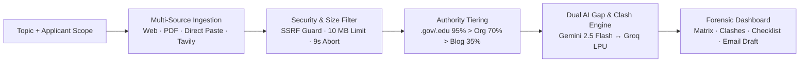
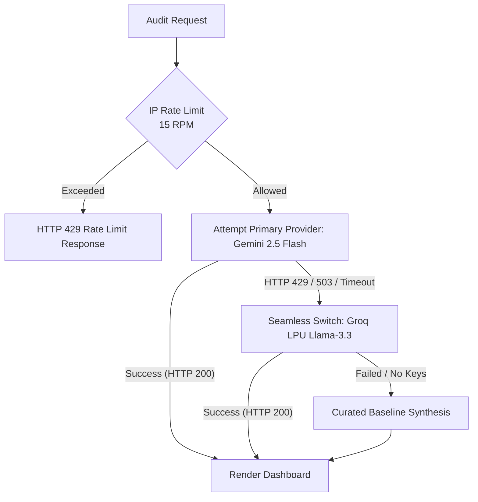

<div align="center">


# BlindspotIQ

### Find what official websites left out.

**An AI-assisted information gap, contradiction, and temporal freshness detection platform.**  
Cross-examines multi-source web circulars, institutional PDFs, and public policies before you submit high-stakes applications.

[](https://nextjs.org/)
[](https://react.dev/)
[](https://www.typescriptlang.org/)
[](https://tailwindcss.com/)
[](https://ai.google.dev/)
[](https://groq.com/)
[](https://github.com)
[](LICENSE)

</div>

---

## 📑 Table of Contents

1. [The Problem: Presence Bias & Silent Omissions](#-the-problem-presence-bias--silent-omissions)
2. [The Solution: Schema-Driven Forensic Auditing](#-the-solution-schema-driven-forensic-auditing)
3. [Key Innovations & Feature Matrix](#-key-innovations--feature-matrix)
4. [3-Minute Hackathon Judge Demo Script](#-3-minute-hackathon-judge-demo-script)
5. [Architecture & Ingestion Pipeline](#-architecture--ingestion-pipeline)
6. [Dual-Engine LLM Fallback & Rate Limiting](#-dual-engine-llm-fallback--rate-limiting)
7. [Enterprise Security & SSRF Guardrails](#-enterprise-security--ssrf-guardrails)
8. [Evidence, Provenance & Responsible AI](#-evidence-provenance--responsible-ai)
9. [Pre-Curated Test Benchmarks](#-pre-curated-test-benchmarks)
10. [Getting Started & Local Setup](#-getting-started--local-setup)
11. [Configuration & Environment Variables](#-configuration--environment-variables)
12. [API Reference](#-api-reference)
13. [Comparison with Competitors](#-comparison-with-competitors)
14. [Future Scope](#-future-scope)

---

## ⚠️ The Problem: Presence Bias & Silent Omissions

People make life-changing decisions regarding **scholarships, visas, grants, academic admissions, and government benefits** based on information scattered across fragmented portals, commercial blogs, and PDF gazettes.

### Where Generic LLMs & Search Engines Fail:
* **The "Presence Bias" Trap:** Standard search engines retrieve pages based on matching keywords; AI chat summarizers condense whatever text is given to them. **Neither detects what was left out.**
* **Silent Omissions (Dark Spots):** An official university scholarship page might detail GPA criteria and award amounts, but omit whether the grant renews annually or requires a separate re-application.
* **Unresolved Contradictions:** A state portal states a deadline of November 15, while an education blog quotes October 1 (citing an obsolete 2024 postal cycle). Generic summarizers blend these into confusing answers.
* **Temporal Drift:** Web guides rarely display explicit deprecation warnings when circular rules change between application cycles.

> **Core Philosophy:** *"Most AI tools tell you what they found. BlindspotIQ tells you what is missing, what clashes, and what is obsolete before you apply."*

---

## 💡 The Solution: Schema-Driven Forensic Auditing

BlindspotIQ transforms any research topic into an inspectable, evidence-backed audit dossier:



1. **Ingest & Verify:** Add official portal links, PDF circulars, or paste raw text. The ingestion engine strips tracking, enforces SSRF boundaries, and establishes domain authority weights.
2. **Derive Expected Dimensions:** An application cannot have a "blind spot" unless the system understands what a *complete* answer looks like. BlindspotIQ derives mandatory decision criteria (e.g., *Eligibility, Award Amount, Deadlines, Renewal Rules, Required Documents, Appeal Recourse*).
3. **Cross-Examine & Resolve:** The system compares claims side by side, highlights verbatim quotes, flags cycle mismatches, and applies an **Authority Resolution Verdict**.
4. **Actionable Resolution:** Omissions and clashes become prioritised verification tasks with 1-click official search shortcuts and **pre-drafted formal inquiry emails** addressed to the issuing office.

---

## 🌟 Key Innovations & Feature Matrix

| Feature | What It Does | Why It Outperforms Standard Tools |
| :--- | :--- | :--- |
| **Schema-Driven Coverage Matrix** | Evaluates 5–7 mandatory decision dimensions across all ingested sources. | Displays a high-impact **Heatmap Grid** for presentations and a **Dimension Card View** with persistent Expand/Collapse controls. |
| **Authority-Weighted Hierarchy** | Classifies publishers into Primary Official (`.gov`/`.edu`, 95% trust), Secondary Aggregator (70%), and Third-Party Unverified (35%). | In a clash, the engine explicitly explains *why* a statutory portal overrides an informal blog. |
| **Applicant Scope Personalisation** | Factors in the applicant's major, country of origin, and target academic cycle. | Catches regional restrictions and cycle drift (e.g., flagging when a source cites a 2024 deadline for a 2026 application). |
| **Fail-Safe Multi-Mode Ingestion** | 4 ingestion vectors: **Auto Web Discovery** (Tavily), **URL Crawler** (Readability), **PDF Parser** (`pdf-parse`), and **Direct Text Paste**. | Direct text paste guarantees **100% presentation uptime** even during network outages or anti-bot Cloudflare blocks. |
| **Automated Inquiry Email Drafter** | Generates pre-filled, formal clarification letters addressed to program coordinators. | Transforms identified dark spots into immediate real-world inquiry emails ready to copy and send. |
| **Dual-Provider LLM Engine** | Integrates Google Gemini 2.5 Flash and Groq LPU (`llama-3.3-70b-versatile`) with automatic failover. | Resilient against API outages, rate limits (HTTP 429), or missing keys with zero-crash baseline fallback. |
| **Forensic Export Dossier** | 1-click export to Markdown (`.md`) or clean, formatted print/PDF view. | Generates an auditable dossier complete with verbatim quotes, confidence ratings, and timestamps. |
| **Client-Side Device Privacy** | Persists recent audit sessions in local browser storage with zero trackers or server cookies. | Revisit past audits instantly without creating an account or storing sensitive personal data on external servers. |

---

## ⏱️ 3-Minute Hackathon Judge Demo Script

Everything in this demo is fully operational in the live application.

| Step | Time | Action | What to Point Out |
| :---: | :---: | :--- | :--- |
| **1** | `0:00` | Open Landing Page (`/`) | Point out the core value proposition: *"Stop guessing what the web left out."* Clean **Forensic Intelligence** palette (Deep Emerald `#059669`, Obsidian `#09090b`, Warm Amber `#d97706`). |
| **2** | `0:30` | Click **"Scholarship Demo"** (`/demo-scholarship`) | Loads the verified hackathon test scenario: *Global STEM Excellence Undergraduate Scholarship (2026–2027 Cycle)*. Point out the **spacious 2-card header**: Audit Summary (left) and Information Completeness with vertical findings pills (right). |
| **3** | `1:00` | Inspect the **Coverage Matrix** | Toggle between **Heatmap Grid** and **Dimension Cards**. Point out the **Red Dark Spot** on *"Multi-Year Renewal Policy"*: completely omitted across all 3 ingested sources. Click *Expand All* to verify persistent state tracking. |
| **4** | `1:45` | Open **Contradictions** Tab | Show the **Side-by-Side Clash** on recommendation letter count: Official Portal says **2 letters**; National Grants Registry says **3 letters**. Point out the **Authority Resolution Verdict** explaining why the official `.gov/.edu` portal takes precedence. |
| **5** | `2:15` | Open **Freshness & Provenance** Tab | Show the **Temporal Alert**: Source 3 (Student blog) cites an obsolete **October 1, 2024** postal cut-off, while the official portal confirmed **November 15, 2026**. Point out the 95% vs 35% authority weights. |
| **6** | `2:40` | Open **Verification Checklist** | Click **"Search Official"** on an item (notice clean Google search with stripped mock domains). Click **"Draft Inquiry"** to reveal the pre-formatted formal email to the foundation coordinator. |
| **7** | `3:00` | Click **Export Markdown (.md)** | Downloads the complete, auditable research dossier ready for filing. |

---

## 🏗️ Architecture & Ingestion Pipeline

BlindspotIQ is built as a unified, high-performance Next.js 16 application running on the modern App Router and Turbopack compiler.

```
blindspotiq/
├── src/
│   ├── app/
│   │   ├── api/
│   │   │   ├── analyze/route.ts      # Core POST analysis endpoint (SSRF + Rate Limited)
│   │   │   └── sample/route.ts       # Pre-curated test benchmark API
│   │   ├── app/
│   │   │   ├── page.tsx              # Research Workspace (Single & Dual Column)
│   │   │   ├── scholarship/page.tsx  # Direct route to Scholarship Audit
│   │   │   └── visa/page.tsx         # Direct route to Nomad Visa Audit
│   │   ├── demo-scholarship/page.tsx # Standalone URL route for Scholarship Demo
│   │   ├── demo-visa/page.tsx        # Standalone URL route for Visa Demo
│   │   ├── icon.svg                  # Vector SVG Favicon (Retina / HiDPI crisp)
│   │   ├── globals.css               # Tailwind v4 theme, Google Fonts, micro-scrollbars
│   │   └── layout.tsx                # Root layout with font pre-connections & metadata
│   ├── components/
│   │   ├── BlindspotLogo.tsx         # Bespoke SVG Aperture & Spotlight Emblem
│   │   ├── PlatformDashboard.tsx     # Executive Dashboard (2-Card spacious metrics)
│   │   ├── TopicInput.tsx            # Multi-mode input (Search, URLs, Direct Text)
│   │   ├── CoverageMatrix.tsx        # Dual-view Heatmap Grid ⟷ Dimension Cards
│   │   ├── ContradictionViewer.tsx   # Side-by-side evidence diff with Authority Verdict
│   │   ├── StructuredSummary.tsx     # Extracted confirmed facts & single-source badges
│   │   ├── TemporalWarnings.tsx      # Cycle mismatch & obsolete year warnings
│   │   ├── SourceCardList.tsx        # Provenance cards with authority weights & tiers
│   │   ├── VerificationChecklist.tsx # Actionable checklist, search shortcuts & email drafts
│   │   └── landing/                  # Landing page (Hero, FeatureGrid, HowItWorks, etc.)
│   ├── lib/
│   │   ├── extractor.ts              # JSDOM + Readability + PDF-Parse + SSRF Guard
│   │   ├── rateLimiter.ts            # Sliding-window IP rate limiter (15 RPM protection)
│   │   ├── llmProvider.ts            # Dual-provider LLM caller (Gemini ↔ Groq)
│   │   ├── gemini.ts                 # Schema prompt synthesis & zero-crash fallback
│   │   ├── tavily.ts                 # Automated official web search integration
│   │   └── sampleData.ts             # Benchmark scenarios (Scholarship & Nomad Visa)
│   └── types/index.ts                # TypeScript strict interfaces & data contracts
└── public/
    ├── logo.svg                      # 512x512 Master vector emblem
    └── favicon.svg                   # Standard SVG favicon
```

---

## ⚡ Dual-Engine LLM Fallback & Rate Limiting

To guarantee uninterrupted availability during high-traffic hackathon judging, BlindspotIQ features an automatic **Dual-Provider Failover Architecture**:



### Free-Tier Quota Alignment:
* **Google Gemini 2.5 Flash:** 15 RPM (Requests Per Minute) · 1,000,000 TPM · 1,500 RPD
* **Groq LPU (`llama-3.3-70b-versatile`):** 30 RPM · 100,000 TPM · 14,400 RPD
* **Automatic Failover:** If Gemini returns `HTTP 429 (Resource Exhausted)` or `503`, the engine logs the event and seamlessly executes through Groq LPU without user interruption.
* **Zero-Crash Baseline:** If both external providers are down or unconfigured, the system returns curated benchmark synthesis so the UI **never crashes or throws an unhandled error**.

---

## 🛡️ Enterprise Security & SSRF Guardrails

BlindspotIQ enforces strict defense-in-depth security across all ingestion vectors:

### 1. Server-Side Request Forgery (SSRF) Guard
All submitted URLs pass through `isSafeUrl()` in [`extractor.ts`](file:///c:/Windows%20(D%20Drive)/VS%20Code/Web/BlindspotIQ/src/lib/extractor.ts#L45-L80) before network dispatch:
* **Protocol Whitelist:** Strictly `http:` and `https:`. File schemes (`file:///`) and local sockets are rejected.
* **Blocked Hostnames & Metadata:** Blocks `localhost`, `127.0.0.1`, `0.0.0.0`, `::1`, and cloud instance metadata addresses (`169.254.169.254`, `metadata.google.internal`).
* **Private IP Range Filter:** Rejects RFC-1918 private IPv4 subnets (`10.0.0.0/8`, `172.16.0.0/12`, `192.168.0.0/16`).

### 2. PDF & Memory Boundaries
* **10 MB Size Ceiling:** Remote documents inspect `Content-Length` headers before streaming to prevent serverless out-of-memory errors.
* **9,000 ms Abort Controller:** Prevents slow or hung government portals from blocking server threads.
* **Text Extraction Cap:** Raw text is sanitized and capped at **10,000 characters per document**.
* **Prompt Slice:** Content is truncated to **4,000 characters per source** in the LLM context window to prevent token exhaustion.
* **Parallel Fetch Limit:** Capped at **5 simultaneous URLs** per audit.

### 3. In-Memory Sliding-Window Rate Limiter
* Implemented in [`rateLimiter.ts`](file:///c:/Windows%20(D%20Drive)/VS%20Code/Web/BlindspotIQ/src/lib/rateLimiter.ts): Tracks requests per client IP.
* Limits client submissions to **15 requests per 60 seconds**.
* Returns standard `HTTP 429` with `Retry-After`, `X-RateLimit-Limit`, and `X-RateLimit-Remaining` headers.
* Periodically purges stale IP records every 5 minutes to maintain zero memory leakage.

---

## 🔍 Evidence, Provenance & Responsible AI

BlindspotIQ adheres to rigorous transparency standards:

| Label | Meaning & Trust Level |
| :--- | :--- |
| **`[Direct Quote]`** | Copied verbatim from the ingested document with publisher attribution. |
| **`[Primary Official (95%)]`** | Verified `.gov`, `.edu`, or statutory issuing authority. |
| **`[Secondary Aggregator (70%)]`** | Structured institutional database or recognized registry. |
| **`[Third-Party Unverified (35%)]`** | Commercial blog or forum post with high editorial drift risk. |
| **`[AI Gap Signal]`** | An inferred omission generated by the reasoning engine. Explicitly labeled so users know it is a prompt for verification, not a legal verdict. |
| **`[Marked Done by You]`** | Ticked by the user in the checklist. BlindspotIQ never falsely claims it verified an off-platform action. |

> [!NOTE]
> BlindspotIQ uses the phrase *"Not found in the sources reviewed"* rather than *"This rule does not exist"*, ensuring applicants verify with the primary issuing office.

---

## 🧪 Pre-Curated Test Benchmarks

BlindspotIQ includes two fully hydrated, offline-safe benchmark scenarios:

### Benchmark 1: Global STEM Undergraduate Scholarship
* **Scenario:** A high-stakes $10,000 STEM grant with conflicting guidance across official notices, scholarship registries, and blogs.
* **Dark Spot Caught:** The official portal omits multi-year renewal GPA maintenance rules.
* **Contradiction Caught:** Official portal requires **2 letters of recommendation**; national registry requires **3 letters**.
* **Freshness Alert:** Student blog cites an obsolete **October 1, 2024** deadline; official portal confirmed **November 15, 2026**.
* **Route:** `/demo-scholarship` (or 1-click in workspace).

### Benchmark 2: Portugal Digital Nomad Residency Visa
* **Scenario:** An international residency visa with varying income and banking requirements across official ministerial gazettes, relocation portals, and expat forums.
* **Dark Spot Caught:** Portuguese bank account requirement omitted from 2 of 3 sources.
* **Contradiction Caught:** Conflicting monthly income minimum (€3,280/mo vs €2,800/mo).
* **Freshness Alert:** Relocation blog cites deprecated SEF border agency rules (replaced by AIMA).
* **Route:** `/demo-visa` (or 1-click in workspace).

---

## 🚀 Getting Started & Local Setup

### Prerequisites
* **Node.js:** `18.18.0` or newer (tested on Node 20 & 22)
* **npm:** `9.0.0` or newer

### Installation

```bash
# 1. Clone the repository
git clone https://github.com/your-username/BlindspotIQ.git
cd BlindspotIQ

# 2. Install dependencies
npm install

# 3. Configure environment variables (optional — sample mode works out of the box!)
cp .env.example .env.local

# 4. Start the Turbopack development server
npm run dev
```

Open [http://localhost:3000](http://localhost:3000) in your browser.

### Production Build

```bash
npm run build
npm run start
```

---

## ⚙️ Configuration & Environment Variables

Create a `.env.local` file in the root directory:

| Variable | Required? | Default | Description |
| :--- | :---: | :---: | :--- |
| `GEMINI_API_KEY` | Optional | `""` | Google Gemini API key. Enables live dynamic reasoning with Gemini 2.5 Flash. |
| `GROQ_API_KEY` | Optional | `""` | Groq API key. Powers ultra-fast secondary failover with Llama-3.3-70B. |
| `GROQ_MODEL` | Optional | `llama-3.3-70b-versatile` | Groq model identifier with JSON mode support. |
| `LLM_PROVIDER` | Optional | `auto` | Preferred provider: `auto` (Gemini $\rightarrow$ Groq failover), `gemini`, or `groq`. |
| `TAVILY_API_KEY` | Optional | `""` | Tavily search API key for automated multi-source web discovery. |

> [!TIP]
> If no API keys are provided, BlindspotIQ runs seamlessly using built-in benchmark synthesis and deterministic heuristics — perfect for offline hackathon judging!

---

## 📡 API Reference

### `POST /api/analyze`
Executes multi-source ingestion, gap detection, contradiction analysis, and checklist generation.

* **Rate Limit:** 15 requests / minute per IP.
* **Request Body:**
```json
{
  "topic": "Portugal Digital Nomad Visa income requirements and renewal rules",
  "urls": [
    "https://vistos.mne.gov.pt/en/national-visas/general-information/type-of-visa/digital-nomad",
    "https://nomadguide.example/portugal-visa"
  ],
  "directTexts": [
    {
      "title": "AIMA Gazette Circular",
      "sourceLabel": "Official Gazette #142",
      "authorityTier": "primary_official",
      "content": "Applicants must demonstrate monthly earnings of four times the national minimum wage..."
    }
  ],
  "scope": {
    "situation": "Remote Software Engineer",
    "jurisdiction": "United States Citizen",
    "targetCycle": "2026 Cycle"
  },
  "useTavilySearch": false,
  "provider": "auto"
}
```

* **Response Headers:**
  * `X-RateLimit-Limit: 15`
  * `X-RateLimit-Remaining: 14`

* **Response Body (Excerpt):**
```json
{
  "id": "analysis-1730467200000",
  "topic": "Portugal Digital Nomad Visa",
  "overallCompletenessScore": 58,
  "highRiskCount": 3,
  "providerUsed": "gemini",
  "modelUsed": "gemini-2.5-flash",
  "gaps": [
    {
      "id": "gap-1",
      "dimensionName": "Banking Proof",
      "riskLevel": "high",
      "gapType": "completely_omitted",
      "description": "Requirement for opening an inland Portuguese bank account omitted across secondary guides.",
      "actionRequired": "Confirm whether NIF and local bank deposit are mandatory before submission."
    }
  ],
  "contradictions": [
    {
      "dimensionName": "Minimum Monthly Income",
      "claimA": "€3,280/month (4x Portuguese Minimum Wage)",
      "sourceA": "MNE Official Portal",
      "claimB": "€2,800/month",
      "sourceB": "Nomad Guide Blog",
      "verdict": "MNE Portal overrides commercial blog (Statutory Authority: 95% vs 35%)."
    }
  ]
}
```

---

## 🏆 Comparison with Competitors

| Feature | BlindspotIQ | Generic AI Search / Perplexity | Traditional Summarizers | Basic Competitor Prototypes |
| :--- | :---: | :---: | :---: | :---: |
| **Detects Omissions (What is MISSING)** | ✅ **Core Focus** | ❌ Presence Bias | ❌ Presence Bias | ⚠️ Keyword matching only |
| **Authority-Weighted Conflict Resolution** | ✅ **.gov/.edu Hierarchy** | ❌ Flattens sources | ❌ Flattens sources | ❌ Simple text diff |
| **Full-Stack Ingestion (Web + PDF + Direct Paste)** | ✅ **4 Modalities** | ⚠️ URLs only | ⚠️ Single doc only | ⚠️ Incomplete PDF support |
| **Zero-Crash Failover (Gemini ↔ Groq)** | ✅ **Automated Failover** | ❌ Single vendor | ❌ Single vendor | ❌ Single key dependency |
| **Pre-Drafted Authority Inquiry Emails** | ✅ **1-Click Generation** | ❌ None | ❌ None | ❌ None |
| **Heatmap Matrix (Grid ⟷ Cards)** | ✅ **Dual View Responsive**| ❌ Markdown prose only| ❌ Plain bullets | ❌ Basic tables |
| **SSRF & 10MB Serverless Protection** | ✅ **Built-In Guardrails** | ⚠️ Managed | ⚠️ Managed | ❌ Unprotected fetch |

---

## 🗺️ Future Scope

* **Multi-Language Gazette Translation:** Real-time cross-lingual gap analysis for non-English regulatory circulars (Portuguese, French, Hindi, Spanish).
* **Live Diff Timeline Tracking:** Webhook monitoring that notifies applicants when an official portal silently modifies eligibility criteria mid-cycle.
* **Direct Browser Extension:** Highlight unstated blind spots and contradictions directly inside institutional scholarship application portals.

---

<div align="center">

**BlindspotIQ** — *Digital Dark Spot Hackathon Challenge (Devengers 2026)*  
Built with precision for applicants making high-stakes decisions.

</div>
