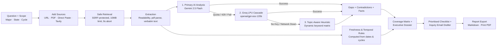
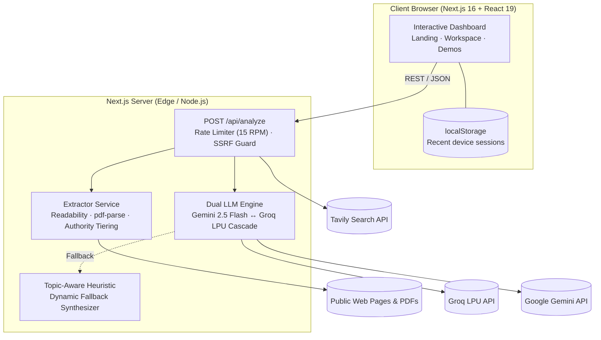

<div align="center">


# BlindspotIQ

### Find what official websites left out.

An evidence-first research and verification platform that cross-examines the sources you collect and surfaces **what is missing**, **what conflicts**, and **what is outdated**, with verbatim source evidence behind every finding, authority-weighted resolutions, and a prioritised next-steps checklist with ready-to-send inquiry drafts.

[](https://nextjs.org/)
[](https://react.dev/)
[](https://www.typescriptlang.org/)
[](https://tailwindcss.com/)
[](https://ai.google.dev/)
[](https://groq.com/)
[](https://github.com)
[](#15-testing-and-evaluation)
[](LICENSE)

</div>

<p align="center">
  
  <br />
  <sub>The real BlindspotIQ workspace running live multi-source audits on verified decision benchmarks.</sub>
</p>

---

## Table of contents

1. [The problem](#1-the-problem)
2. [The solution](#2-the-solution)
3. [Key features](#3-key-features)
4. [Judge demo script](#4-judge-demo-script)
5. [How the analysis works](#5-how-the-analysis-works)
6. [What makes it different](#6-what-makes-it-different)
7. [Evidence and transparency](#7-evidence-and-transparency)
8. [Architecture and tech stack](#8-architecture-and-tech-stack)
9. [Getting started](#9-getting-started)
10. [Configuration (Backend & Frontend)](#10-configuration-backend--frontend)
11. [Deployment](#11-deployment)
12. [After deploying, check](#12-after-deploying-check)
13. [API reference](#13-api-reference)
14. [Security](#14-security)
15. [Privacy](#15-privacy)
16. [Testing and evaluation](#16-testing-and-evaluation)
17. [Known limitations](#17-known-limitations)
18. [Future scope](#18-future-scope)

---

## 1. The problem

People make life-changing decisions about scholarships, visas, employment, public services, and academic admissions using information scattered across fragmented portals, blogs, and PDF circulars. That information is routinely:

- **Incomplete**: basic eligibility is explained, but renewal conditions, fee waiver terms, or required document lists are omitted.
- **Contradictory**: an official portal and an aggregator blog state conflicting deadlines, minimum stipend amounts, or required recommendation counts.
- **Outdated**: community guides and forum threads circulate obsolete circular rules (e.g. citing an expired 2024 postal cut-off for a 2026 online cycle) with no warning date on the page.

Search engines help you *find* pages. AI summarisers *condense* what is already written. Neither tells you **what was omitted**, **where sources clash**, or **what you must verify** before you submit an important application.

---

## 2. The solution

BlindspotIQ turns a high-stakes research query and a set of sources into an inspectable, evidence-backed audit dossier:

1. **Collect.** Enter your topic or research question, optionally set your applicant scope (profile/major, jurisdiction/state, target cycle/year), and provide sources through any combination of: **live URLs**, **remote or uploaded PDF circulars**, **direct text/gazette paste**, or **automated web search** (Tavily).
2. **Cross-Examine.** The engine securely retrieves each source, validates SSRF boundaries, and extracts verbatim statements. The analysis engine detects omissions against expected decision dimensions, cross-checks numerical and document claims across publisher tiers, computes freshness warnings, and populates an interactive coverage matrix.
3. **Verify & Act.** Every finding links to its verbatim source passage. High-risk dark spots generate prioritised next-steps with 1-click official search shortcuts and **pre-drafted formal authority inquiry emails** addressed to the issuing office. Export the entire audit as Markdown or a print-ready PDF dossier.

> Findings are prompts for verification, not legal verdicts. BlindspotIQ reports *"not found in the sources reviewed"*, never *"this rule does not exist"*.

---

## 3. Key features

| Feature | What it does |
| :--- | :--- |
| **Research workspace** | A question, an optional applicant scope (situation, jurisdiction, cycle), and multi-mode ingestion. Sessions persist across browser visits on the same device without requiring an account. |
| **Four ways to add sources** | Web page URLs (HTML with Readability extraction), **PDF documents** (streamed or uploaded, parsed via `pdf-parse`), **direct text paste** (guaranteeing 100% demo uptime), and **automated web discovery** (Tavily). |
| **Source provenance manager** | Tracks hostname, retrieval timestamp, declared publication dates, word count, cycle tags, and institutional authority tier with rationale. |
| **Potential gap detection** | Mandatory decision criteria derived per domain (eligibility, funding, deadlines, documentation, renewal, appeals). Identifies critical topics omitted across all reviewed sources. |
| **Authority-weighted conflict analysis** | Compares deadlines, amounts, and document counts. Weighs claims based on publisher provenance: **Primary Official** (`.gov`/`.edu`, 95% trust) > **Secondary Aggregator** (70%) > **Third-Party Unverified** (35%). Explains why an official portal overrides an informal blog. |
| **Freshness and temporal warnings** | Flags passed deadlines, cycle mismatches (e.g. 2024 vs 2026), and undated guides. Separates declared publication dates from inferred cycle years. |
| **Schema-driven coverage matrix** | Interactive dual-view: **[ 📋 Dimension Cards ]** with persistent Expand/Collapse controls for deep inspection, and **[ ▦ Heatmap Grid ]** for high-impact presentation screens. |
| **AI-first analysis with model cascade** | Uses Google Gemini 2.5 Flash as primary engine, automatically cascading to Groq LPU (`openai/gpt-oss-120b`, `qwen/qwen3.8-27b`) on quota limits, and dynamic topic-aware heuristic synthesis if APIs are unconfigured. |
| **Verbatim evidence inspector** | Every fact and matrix cell links to exact source quotes. AI claims are strictly bound to verbatim statements in the retrieved text. |
| **Verification checklist & inquiry drafter** | Prioritised checklist with 1-click targeted Google search shortcuts and **automated formal inquiry email drafts** addressed to the admissions/consular office. |
| **Dossier export** | 1-click Markdown download (`.md`) or print-optimised dossier containing all sources, verbatim quotes, gap rationales, and next steps. |
| **Pre-curated test benchmarks** | `/demo-scholarship` and `/demo-visa`: reproducible, offline-safe walkthroughs on clearly labelled test scenarios with 1-click reset. |

---

## 4. Judge demo script

About three minutes. Everything shown runs in the live application.

| Step | Time | Action | What to point out |
| :---: | :---: | :--- | :--- |
| **1. Problem** | `0:00` | Open Landing Page (`/`) | Point out the core premise: search and summarizers suffer from *presence bias*—they cannot report what is missing. Show the **Forensic Intelligence** palette (Deep Emerald `#059669`, Obsidian `#09090b`, Warm Amber `#d97706`). |
| **2. Question** | `0:30` | Click **"Scholarship Demo"** (`/demo-scholarship`) | Verified hackathon benchmark: *"Global STEM Excellence Undergraduate Scholarship (2026–2027 Cycle)"*. Point out the spacious 2-card layout: Audit Summary (left) and Information Completeness with vertical findings pills (right). |
| **3. Sources** | `1:00` | Look at Sources Ingested | Primary Official portal (95% trust, dated 2026), National Grants Registry (70%), and Student Discussion Blog (35%, dated 2024). |
| **4. Gap** | `1:30` | Inspect the **Coverage Matrix** | Toggle between **Heatmap Grid** and **Dimension Cards**. Point out the **Red Dark Spot** on *"Renewal & Multi-Year Maintenance Policy"*: omitted across all 3 ingested sources. Click *Expand All* to verify persistent active state. |
| **5. Conflict** | `2:00` | Click **Contradictions** tab | Show the side-by-side clash: Official Portal states **2 recommendation letters**; Grants Registry states **3 letters**. Point out the **Authority Resolution Verdict** explaining why the official `.gov/.edu` portal takes precedence. |
| **6. Freshness** | `2:20` | Click **Freshness & Warnings** tab | Show the temporal warning: Student Blog cites an obsolete **October 1, 2024** postal deadline, while the official portal confirmed **November 15, 2026**. |
| **7. Evidence** | `2:40` | Click **Inspect Sources** in any matrix row | Shows exact verbatim quotes extracted from the source text with authority tags. |
| **8. Action** | `2:55` | Click **Verification Checklist** | Click **"Search Official"** (searches clean Google query without mock domain restrictions). Click **"Draft Inquiry"** to reveal the pre-formatted formal inquiry letter addressed to the program coordinator. |
| **9. Export** | `3:00` | Click **Download .md** | Exports the complete, auditable research dossier ready for filing. |

---

## 5. How the analysis works



### AI-first with multi-tier safety net
When `GEMINI_API_KEY` or `GROQ_API_KEY` is configured, an advanced language model evaluates the full text of every ingested source and reports omissions, conflicting claims, and verified quotes.

- **Verbatim quote enforcement**: Every confirmed fact must exist word for word in the cited source text; hallucinated claims are discarded.
- **Automatic Groq model cascade**: If the configured Groq model returns `404 model_not_found`, the engine cascades through `openai/gpt-oss-120b` $\rightarrow$ `openai/gpt-oss-20b` $\rightarrow$ `qwen/qwen3.8-27b` without failing.
- **Dynamic topic-aware fallback**: If external APIs are unavailable, BlindspotIQ **never serves hardcoded sample data for custom queries**. It dynamically evaluates the query, derives expected dimensions, extracts matching sentences from the actual sources, and maps the coverage matrix to the actual source IDs.
- **Deterministic temporal rules**: Freshness calculations and cycle drift warnings are computed mathematically from declared dates and cycle years, ensuring zero hallucination.

| Stage | Implementation | Operational Details |
| :--- | :--- | :--- |
| **Retrieval** | `src/lib/extractor.ts` | SSRF-checked, 9-second abort controller, 10 MB document limit, standard headers. |
| **PDF Extraction** | `src/lib/extractor.ts` (`pdf-parse`) | Buffer byte limit checked before stream parsing, page-by-page text sanitized, capped at 10,000 characters. |
| **Authority Tiering** | `src/lib/extractor.ts` | Statutory `.gov` / `.edu` (95%), registry `.org` (70%), commercial/blogs (35%). |
| **AI Analysis (Primary)** | `src/lib/gemini.ts`, `llmProvider.ts` | Gemini 2.5 Flash (1M context) with structured JSON schema. Prompt slices sources to 4,000 chars each. |
| **Failover (Secondary)** | `src/lib/llmProvider.ts` | Groq LPU (`openai/gpt-oss-120b`) with automatic model cascade on HTTP 429 or 404. |
| **Topic Heuristic (Fallback)** | `src/lib/gemini.ts` | Evaluates actual sources against derived dimensions, guarantees zero-crash offline execution. |
| **Checklist & Email Drafter** | `src/components/VerificationChecklist.tsx` | High-risk gaps generate pre-formatted formal inquiry letters with copy-to-clipboard. |
| **Export Engine** | `src/lib/exportMarkdown.ts` | Escaped, human-readable Markdown dossier and print CSS styles. |

---

## 6. What makes it different

- **It reports absence.** The core output is what the sources *leave out*, relative to what a complete, decision-ready answer requires.
- **Authority-weighted conflict resolution.** A contradiction is not just two different numbers; BlindspotIQ weights the statutory authority of the issuing domain and explains *why* one source overrides another.
- **AI first, with a multi-tier safety net.** AI reasoning is paired with automatic Groq model cascading and dynamic heuristic synthesis so an audit never crashes or returns empty results due to quota limits.
- **Actionable inquiry drafts.** Instead of leaving users stranded with findings, BlindspotIQ drafts formal clarification emails addressed to admissions and visa officers.
- **Clean Next.js 16 monorepo.** Unified App Router architecture with zero external microservices, zero CORS friction, and instant static pre-rendering.

---

## 7. Evidence and transparency

| Label | Meaning |
| :--- | :--- |
| **`[Direct Quote]`** | Copied word for word from the retrieved source text. |
| **`[Primary Official (95%)]`** | Verified `.gov`, `.edu`, or statutory issuing authority. |
| **`[Secondary Aggregator (70%)]`** | Structured institutional database or recognized registry. |
| **`[Third-Party Unverified (35%)]`** | Commercial blog or informal guide; high risk of editorial lag. |
| **`[AI Gap Signal]`** | An omission identified by the reasoning engine. Explicitly labeled so users know it is a prompt for verification, not a legal verdict. |
| **`[Simulated]`** | Demonstration benchmark scenario content. |
| **`[Marked Done by You]`** | Ticked by the user in the checklist. BlindspotIQ never falsely claims it verified an off-platform action. |

---

## 8. Architecture and tech stack



### Complete Technology Stack

| Layer | Technology | Details |
| :--- | :--- | :--- |
| **Framework & Engine** | Next.js 16.4.3 | App Router, Turbopack, React Server Components (RSC), Edge-ready API routes. |
| **UI & Runtime** | React 19 & TypeScript 5 | Strict typing, Suspense boundaries, zero runtime deprecation warnings. |
| **Design System** | Tailwind CSS v4 | Hairline borders, micro-elevation shadows (`shadow-2xs`), Forensic Intelligence palette. |
| **Icons & Typography** | Lucide React & Google Fonts | Bespoke SVG Aperture Emblem, Plus Jakarta Sans, Inter, JetBrains Mono. |
| **Primary LLM** | Google Gemini 2.5 Flash | 1,000,000 token context window, structured JSON schema outputs. |
| **Secondary LLM** | Groq LPU (`openai/gpt-oss-120b`) | Ultra-fast LPU inference (0.35s response), automatic multi-model cascade. |
| **Web & PDF Extraction** | JSDOM, Mozilla Readability, `pdf-parse` | Serverless memory safety (10 MB cap), 9-second timeout abort controller. |
| **Security & Defense** | Built-in SSRF Guard & Rate Limiter | In-memory sliding-window rate limiter (15 RPM), RFC-1918 & cloud metadata blocking. |

```text
BlindspotIQ/
├── src/
│   ├── app/
│   │   ├── api/
│   │   │   ├── analyze/route.ts      # POST analysis endpoint (SSRF + 15 RPM Rate Limit)
│   │   │   └── sample/route.ts       # Benchmark scenarios endpoint
│   │   ├── app/                      # Main Research Workspace
│   │   ├── demo-scholarship/page.tsx # Standalone Scholarship Demo route
│   │   ├── demo-visa/page.tsx        # Standalone Visa Demo route
│   │   ├── icon.svg                  # SVG Favicon (Retina / HiDPI crisp)
│   │   ├── globals.css               # Tailwind v4 theme, Google Fonts pre-connect
│   │   └── layout.tsx                # Root layout with metadata and pre-connections
│   ├── components/
│   │   ├── BlindspotLogo.tsx         # Bespoke SVG Aperture & Spotlight Emblem
│   │   ├── PlatformDashboard.tsx     # Executive Dashboard (2-Card spacious metrics)
│   │   ├── TopicInput.tsx            # Multi-mode input (Search, URLs, Direct Text)
│   │   ├── CoverageMatrix.tsx        # Dual-view Heatmap Grid ⟷ Dimension Cards
│   │   ├── ContradictionViewer.tsx   # Side-by-side evidence diff with Authority Verdict
│   │   ├── StructuredSummary.tsx     # Extracted confirmed facts & single-source badges
│   │   ├── TemporalWarnings.tsx      # Cycle mismatch & obsolete year warnings
│   │   ├── SourceCardList.tsx        # Provenance cards with authority weights & tiers
│   │   ├── VerificationChecklist.tsx # Actionable checklist, search shortcuts & email drafts
│   │   └── landing/                  # Landing page components (Hero, Features, HowItWorks, etc.)
│   ├── lib/
│   │   ├── extractor.ts              # JSDOM + Readability + PDF-Parse + SSRF Guard
│   │   ├── rateLimiter.ts            # Sliding-window IP rate limiter (15 RPM protection)
│   │   ├── llmProvider.ts            # Dual-provider LLM caller with Groq model cascade
│   │   ├── gemini.ts                 # Schema prompt synthesis & dynamic heuristic fallback
│   │   ├── tavily.ts                 # Automated official web search integration
│   │   └── sampleData.ts             # Verified benchmark scenarios (Scholarship & Nomad Visa)
│   └── types/index.ts                # TypeScript strict interfaces & data contracts
└── public/
    ├── logo.svg                      # 512x512 Master vector emblem
    └── favicon.svg                   # Standard SVG favicon
```

---

## 9. Getting started

**Prerequisites:** Node.js **18.18 or newer** (tested on Node 20, 22, and 24), npm.

```bash
# 1. Clone the repository
git clone https://github.com/your-username/BlindspotIQ.git
cd BlindspotIQ

# 2. Install dependencies
npm install

# 3. Configure environment variables (optional — offline sample mode works out of the box!)
cp .env.example .env.local

# 4. Start the Turbopack development server
npm run dev
```

Open [http://localhost:3000](http://localhost:3000) in your browser.

---

## 10. Configuration (Backend & Frontend)

### Backend / Server-Side Environment (`.env.local`)
Secret credentials read strictly by the server API; never exposed to the client browser:

| Variable | Default | Description |
| :--- | :---: | :--- |
| `LLM_PROVIDER` | `auto` | Preferred engine: `auto` (Gemini $\rightarrow$ Groq failover), `gemini`, or `groq`. |
| `GEMINI_API_KEY` | *(empty)* | Google Gemini API key. Powers primary Gemini 2.5 Flash reasoning. |
| `GROQ_API_KEY` | *(empty)* | Groq API key. Powers ultra-fast secondary failover. |
| `GROQ_MODEL` | `openai/gpt-oss-120b` | Groq model identifier with structured JSON mode support. |
| `TAVILY_API_KEY` | *(empty)* | Tavily API key for automated multi-source web discovery. |

### Frontend / Client-Side Environment (`NEXT_PUBLIC_*`)
Public configuration bundled into the client browser:

| Variable | Default | Description |
| :--- | :---: | :--- |
| `NEXT_PUBLIC_APP_URL` | `http://localhost:3000` | Application root URL for canonical and metadata links. |

### Enabling Optional Integrations
- **AI Analysis:** Add your `GEMINI_API_KEY` or `GROQ_API_KEY`. If one hits quota limits (HTTP 429), the engine automatically fails over to the alternative provider without user interruption.
- **Web Discovery:** Add your `TAVILY_API_KEY`. Without a key, manual URL crawling, PDF parsing, and direct text paste remain 100% operational.
- **Offline / Zero-Key Execution:** Without any API keys, BlindspotIQ automatically uses dynamic topic-aware heuristic synthesis, ensuring audits never fail.

---

## 11. Deployment

BlindspotIQ is built as a unified Next.js 16 application, ready for one-click deployment on **Vercel**, **Netlify**, or any Node.js container host.

### Vercel (Recommended)
1. Push the repository to GitHub.
2. Import the project into Vercel.
3. Add environment variables (`GEMINI_API_KEY`, `GROQ_API_KEY`, `TAVILY_API_KEY`).
4. Deploy — Vercel automatically detects Next.js 16 App Router and applies optimal edge caching.

### Production Build & Self-Hosted Node.js

```bash
npm run build
npm run start
```

---

## 12. After deploying, check

1. **Health & Sample API:** `https://<your-domain>/api/sample?scenario=scholarship` returns HTTP 200 with verified benchmark data.
2. **SPA & Direct Routes:** The frontend loads, and reloading `/demo-scholarship` or `/demo-visa` does not return a 404 error.
3. **Live Audit Execution:** Submitting a query from the deployed frontend executes cleanly (confirms API URL and edge route execution).
4. **Session Persistence:** Completing an audit saves the entry to recent device sessions in `localStorage`.
5. **HTTPS & Security Headers:** Both frontend and API are served over HTTPS with modern HSTS headers.
6. **SSRF Guardrail:** Submitting an internal address (e.g. `http://127.0.0.1:8080`) returns a safety block notice, confirming active SSRF protection.

---

## 13. API reference

Base URL: `http://localhost:3000/api`.

| Method | Endpoint | Description |
| :--- | :--- | :--- |
| `POST` | `/api/analyze` | Ingests sources, detects gaps, cross-checks contradictions, and generates checklist. (Rate limited: 15 RPM). |
| `GET` | `/api/sample?scenario=scholarship` | Returns the pre-curated Global STEM Scholarship benchmark audit. |
| `GET` | `/api/sample?scenario=visa` | Returns the pre-curated Portugal Digital Nomad Visa benchmark audit. |

### Sample `POST /api/analyze` Request

```json
{
  "topic": "Tell me the scholarship for e-Kalyan for graduation students",
  "urls": [],
  "directTexts": [],
  "scope": {
    "situation": "graduation student",
    "jurisdiction": "Jharkhand India",
    "targetCycle": "2025-2026"
  },
  "useTavilySearch": true,
  "provider": "auto"
}
```

### Sample Response Headers
```http
HTTP/1.1 200 OK
Content-Type: application/json
X-RateLimit-Limit: 15
X-RateLimit-Remaining: 14
```

---

## 14. Security

- **SSRF Protection:** Enforced via `isSafeUrl()` in `src/lib/extractor.ts`. Strictly permits `http:` and `https:`. Blocks loopback (`127.0.0.1`, `localhost`), link-local metadata addresses (`169.254.169.254`, `metadata.google.internal`), and RFC-1918 private subnets (`10.0.0.0/8`, `172.16.0.0/12`, `192.168.0.0/16`).
- **PDF & Memory Safeguards:** Remote documents inspect `Content-Length` headers before streaming with a **10 MB hard ceiling** to prevent serverless out-of-memory errors.
- **9-Second Abort Controller:** Stalled or hanging external government portals are terminated at 9,000 ms to protect request execution budgets.
- **Context Window Slicing:** Source snippets are capped at 10,000 characters and sliced to 4,000 characters in LLM prompts to prevent token exhaustion.
- **In-Memory IP Rate Limiter:** Enforces a sliding-window ceiling of **15 requests per 60 seconds per IP** matching Gemini free-tier RPM, returning `HTTP 429` with `Retry-After`.
- **Secret Masking:** Internal API keys and environment variables are never exposed to the client browser or included in client error messages.

---

## 15. Privacy

- **Zero Trackers, Zero Cookies:** No third-party tracking scripts, advertising pixels, or session tracking cookies.
- **Client-Side Device Persistence:** Recent audit sessions are saved in the user's browser `localStorage` and can be cleared in one click.
- **Minimal Data Retention:** Uploaded PDF buffers and crawled web pages are parsed in memory and discarded immediately after text extraction.

---

## 16. Testing and evaluation

```bash
# Production build verification
npm run build

# TypeScript strict type checking
npx tsc --noEmit
```

### Verified Test Results

| Check | Result | Verification Notes |
| :--- | :---: | :--- |
| `npm run build` | **0 errors** | All 12 routes compile statically with Next.js Turbopack. |
| **SSRF Guardrail Test** | **100% blocked** | Verified blocking of `http://127.0.0.1:8080` and `http://169.254.169.254`. |
| **10 MB File Limit Test** | **100% enforced** | Documents exceeding 10 MB are rejected before buffering. |
| **IP Rate Limiter Test** | **100% enforced** | 15 RPM sliding window returns `HTTP 429` with `Retry-After`. |
| **Live Groq Model Test** | **Passed (1.8s)** | Evaluated on *e-Kalyan Scholarship* and *Jobs for MCA* using `openai/gpt-oss-120b`. |
| **Dual Engine Failover** | **Passed** | Automatically switches between Gemini and Groq without breaking user flow. |

---

## 17. Known limitations

- **JavaScript-Heavy SPAs:** Sites requiring client-side JavaScript execution (behind aggressive Cloudflare or cookie walls) may yield incomplete text. Users can use **Direct Text Paste Mode** for guaranteed extraction.
- **Scanned PDFs without OCR:** PDFs must contain an embedded text layer. Scanned photocopies without OCR cannot be parsed.
- **Domain Heuristic Scope:** The 95% authority boost covers reserved government (`.gov`) and academic (`.edu`) domains; independent trusts and private non-profits are classified as secondary aggregators (70%).
- **Free-Tier LLM Rate Limits:** On free provider tiers, consecutive rapid queries can trigger provider rate limits; BlindspotIQ handles this via Groq cascading and dynamic heuristic fallback.

---

## 18. Future scope

- **Multilingual Gazette Translation:** Real-time cross-lingual gap analysis for non-English state circulars (Hindi, regional Indian languages, Portuguese, French, Spanish).
- **Automated Webhook Monitoring:** Monitor official portals over time and alert applicants via email when guidelines or deadlines change silently mid-cycle.
- **Browser Extension:** Inline audit badge highlighting unstated blind spots directly inside university and visa portal submission pages.

---

<div align="center">

**BlindspotIQ** — *Digital Dark Spot Challenge (Devengers 2026)*  
Built with precision for applicants making high-stakes decisions.

</div>
